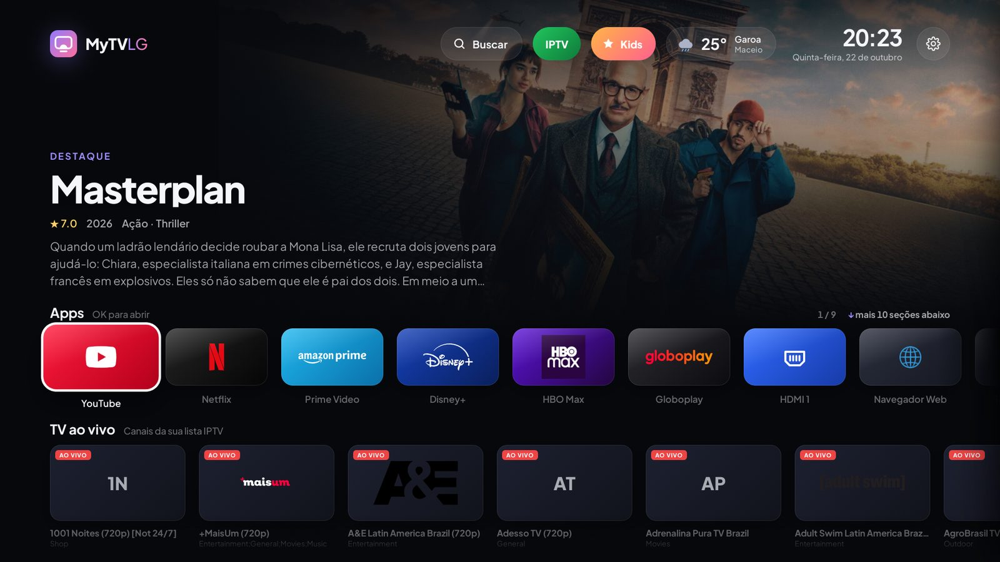

# MyTVLG

An ad-free home screen for LG webOS TVs: your apps and HDMI inputs, new releases and where to watch
them, series tracking, weather, news, a Kids zone and optional IPTV. Installed through the official
Developer Mode, no root needed.



## Quick start

```bash
git clone https://github.com/jholhewres/mytvlg.git && cd mytvlg
python3 tools/deploy.py pair --host <TV_IP>
python3 tools/deploy.py install --host <TV_IP> --auto-renew
```

## Documentation

| | English | Português |
|---|---|---|
| Install | [docs/en/installation.md](docs/en/installation.md) | [docs/pt-BR/instalacao.md](docs/pt-BR/instalacao.md) |
| Configure | [docs/en/configuration.md](docs/en/configuration.md) | [docs/pt-BR/configuracao.md](docs/pt-BR/configuracao.md) |
| Develop & build | [docs/en/development.md](docs/en/development.md) | [docs/pt-BR/desenvolvimento.md](docs/pt-BR/desenvolvimento.md) |

## Contributing

See [CONTRIBUTING.md](CONTRIBUTING.md) and the [Code of Conduct](CODE_OF_CONDUCT.md)
([Português](docs/pt-BR/codigo-de-conduta.md)). Security reports: [SECURITY.md](SECURITY.md).

## Credits and license

Started as a fork of [FreeMyTvWebOS](https://github.com/danielthejoker18/FreeMyTvWebOS). Data from
[TMDB](https://www.themoviedb.org/), [Open-Meteo](https://open-meteo.com/) and [TVMaze](https://www.tvmaze.com/).
This product uses the TMDB API but is not endorsed or certified by TMDB. LG, webOS and all brand names and
logos belong to their owners; this project is not affiliated with LG Electronics.

[MIT](LICENSE)
