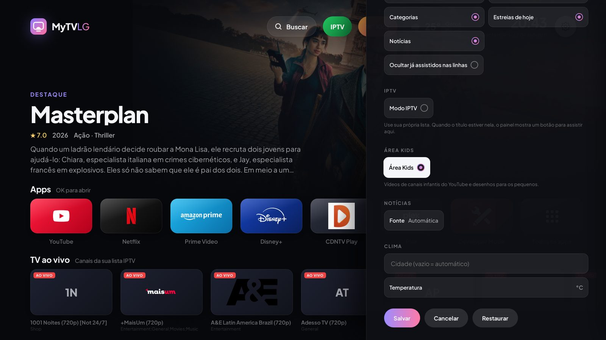
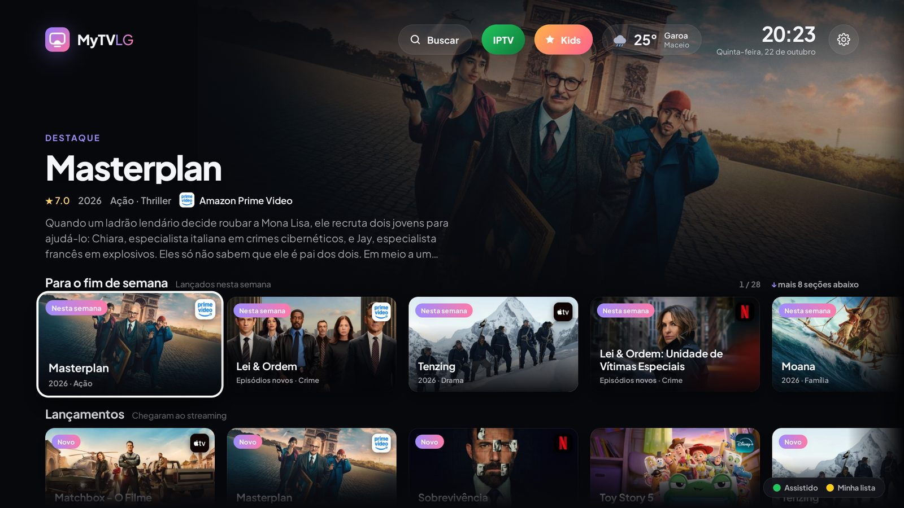
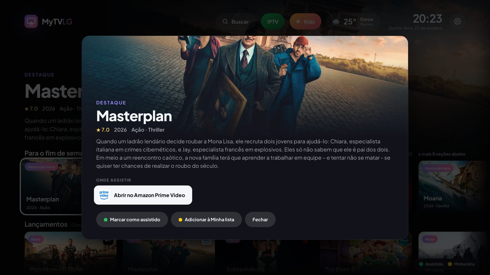
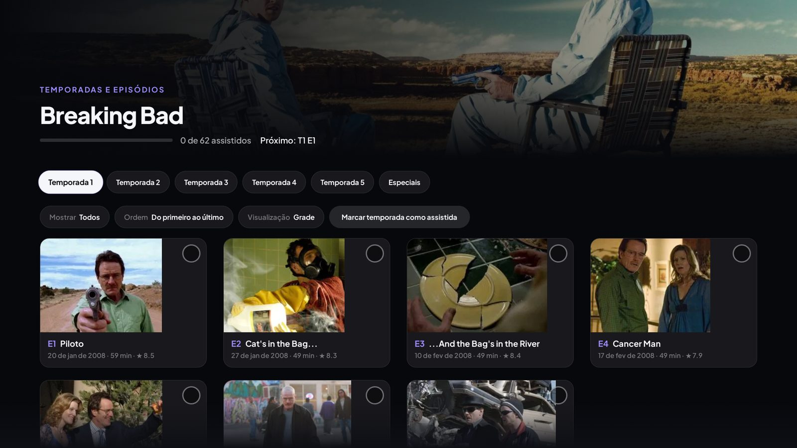
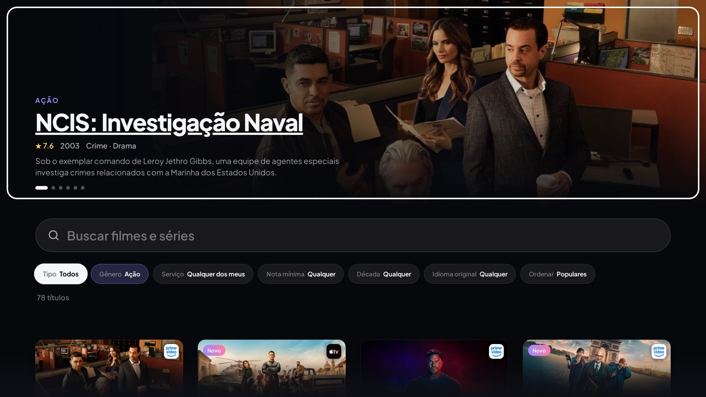
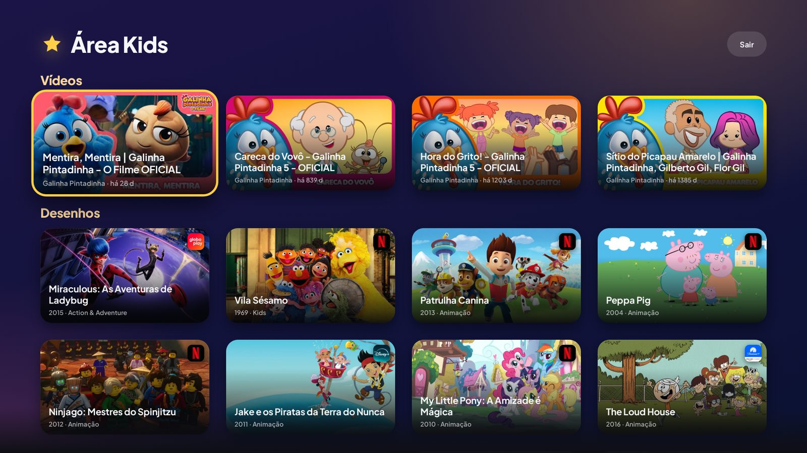
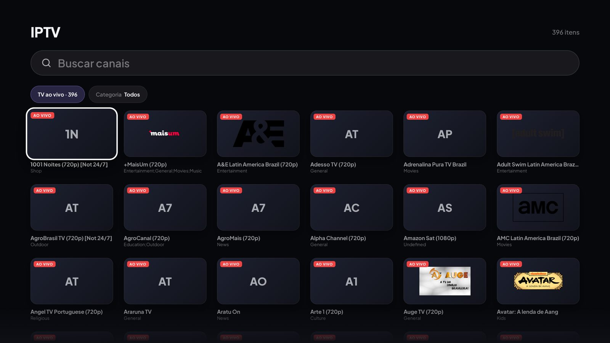
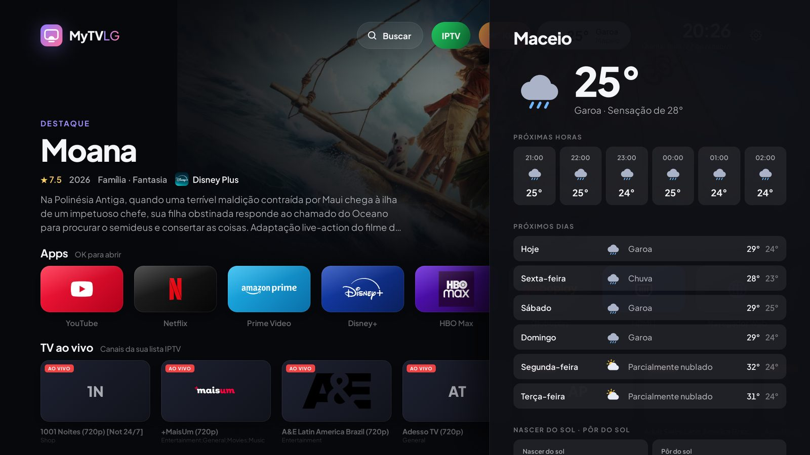

# Configuração

**English:** [../en/configuration.md](../en/configuration.md)

Tudo é configurado na TV em **Ajustes** (engrenagem). Ajustes e chaves ficam salvos só na TV.
**Voltar** salva e fecha; **Cancelar** descarta as mudanças.

## Controle remoto

| Tecla | Ação |
|---|---|
| Setas / ponteiro do Magic Remote | Navegar |
| OK | Abrir |
| Voltar | Fechar a tela atual |
| Verde | Marcar ou desmarcar o título em foco como assistido |
| Amarelo | Adicionar ou remover o título em foco da Minha lista |

## Tela inicial

- **Apps:** escolha e reordene os apps exibidos (depois de aceitar a conexão com a TV, todos os apps instalados
  aparecem). Dê nome a cada entrada HDMI com o aparelho ligado nela.
- **Linhas da tela inicial:** ligue ou desligue cada linha (continuar assistindo, TV ao vivo, fim de semana,
  Minha lista, para você, lançamentos, séries em alta, anime, infantil, categorias, estreias de hoje,
  já assistidos, notícias).
- **Tela:** tema, formato do relógio, idioma, tempo do protetor de tela e contador de FPS.

## Filmes e séries

- **Chave da API do TMDB:** necessária para lançamentos, recomendações, busca, categorias e onde assistir.
- **Região do streaming:** por padrão, a da TV.
- **Serviços exibidos:** desmarque os serviços que você não usa. Títulos que só estão neles somem.
- **Nota mínima** e uma **chave OMDb** opcional para usar a nota do IMDb no lugar da do TMDB.

OK num título mostra onde assistir e os botões de assistido e Minha lista. Séries também abrem
**Temporadas e episódios**, com progresso, filtros, ordem e visualização em grade ou lista.

## Busca e categorias

**Buscar** encontra filmes e séries pelo nome ou explora o catálogo com filtros de tipo, gênero, serviço,
nota mínima, década, idioma original e ordem. Os cards de categoria abrem a mesma tela com destaques.

## Área Kids

Vídeos de canais infantis do YouTube e desenhos para os pequenos. Vem ligada; dá para desligar nos Ajustes.

## IPTV (opcional)

Ligue o **Modo IPTV** e escolha a fonte:

- **Lista M3U:** a URL da lista.
- **Xtream Codes:** URL do servidor, usuário e senha.

A lista carrega ao abrir o app. Você ganha **TV ao vivo** (canais por grupo, ↑ ↓ troca de canal), os
**filmes e séries** da lista com as categorias dela, e um botão **IPTV** em todo título encontrado na lista.
O player continua de onde você parou e marca como assistido perto do fim.

O MyTVLG não traz listas nem canais. Use apenas conteúdo que você tem direito de assistir.

## Notícias e clima

Escolha a fonte de notícias (ou qualquer feed RSS). O clima usa sua cidade ou, se vazio, uma localização aproximada.

